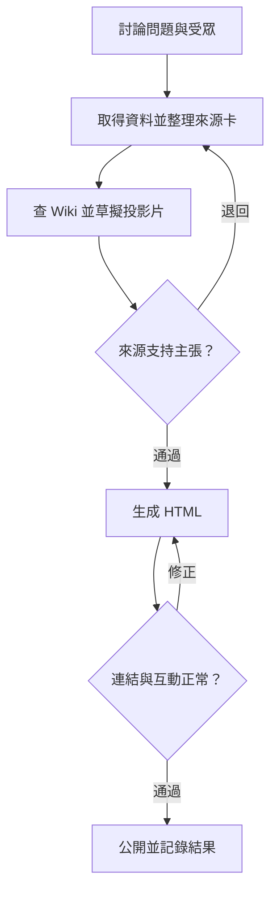

# MBTI_wiki
人格觀察簿
同一個人，為什麼會測出兩種 MBTI？這是一份給初學者的 LLM Wiki 與互動 HTML 講義。從虛構人物小安的 INFP／ENFP 結果出發，依序認識四組偏好、人格類型、重測判讀、信度與效度，以及大五人格的連續特質描述。

公開講義庫 · LLM Wiki · 製作與檢查紀錄
教學 HTML 簡報
公開版有四份獨立講義，共 16 頁。可使用畫面按鈕或鍵盤方向鍵翻頁。
講義	頁數	學習任務
MBTI 入門與四組偏好	6	用小組報告、作業和旅行理解四組偏好。
16 種人格代碼	3	點選代碼拆解字母，比較 INFP 與 ENFP。
重測、信度與效度	5	操作示意滑桿，區分分類結果、分數信度與解讀所需的效度證據。
大五人格與結果判讀	2	比較四字母分類與連續特質，回到開場情境練習判讀。

LLM Wiki 與簡報對照
先和 AI 討論主題、受眾與教學互動，再將兩份官方說明與三篇研究摘要整理成 Wiki。每張來源卡保存來源 ID、原始連結、查閱位置與中文摘要。由投影片底部的「本頁依據」可回查 Wiki，Wiki 底部也提供逐頁對照。
來源卡	摘要用途	對應投影片舉例
[S01 四組偏好](wiki/sources/S01.md)	MBTI 偏好定義	入門第 2 頁
[S02 結果回饋](wiki/sources/S02.md)	Best-Fit Type 解讀流程	重測第 2 頁
[S03 分數信度](wiki/sources/S03.md)	量尺分數的信度	重測第 4 頁
[S04 類型與維度](wiki/sources/S04.md)	二分假設與連續維度	重測第 1 頁
[S05 大五人格](wiki/sources/S05.md)	BFI-2 的五領域與十五面向	大五第 1 頁

Loop 與 Graph

每新增資料都會重做原文定位與摘要，每新增投影片都會重跑主張與來源的核對。來源範圍不足時回查原始資料或縮小主張。翻頁、錨點或互動異常時回到 HTML 生成與驗收。
實測與反思
2026 年 11 月 18 日複核公開版。四份講義末頁分別顯示 6／6、3／3、5／5、2／2，下一頁停用。重測滑桿在 49、50、51 分依序顯示 I、E、E。重測第 2 頁的「分數信度」成功跳到 Wiki 的 S03，第 5 頁的組長題能即時顯示解析。

製作紀錄的三個刻意設計案例中，有兩個在「來源轉成教學例句」時被退回。第一個把量尺分數信度等同於四字母一致率，第二個把滑桿的示意門檻當成官方計分。我把來源 ID、指標範圍與示意標註的檢查提前到草稿完成後、生成 HTML 前，並在生成後保留操作驗收。
檔案與離線瀏覽
- wiki/index.md 收錄 Wiki 索引，`wiki/sources/` 存放五張來源卡。
- dist/ 包含講義入口、獨立投影片、Wiki 網頁及製作紀錄。
- build.py 讀取來源卡與講義內容，生成網站。
- AGENTS.md 記錄專案的內容與修改規則。
下載專案後，以瀏覽器開啟 dist/index.html 即可離線操作。從專案根目錄執行 python build.py 可重新生成網頁。

雲科大 M11517035 資工碩一 黃秋賓
